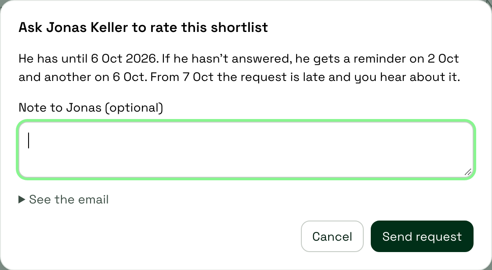
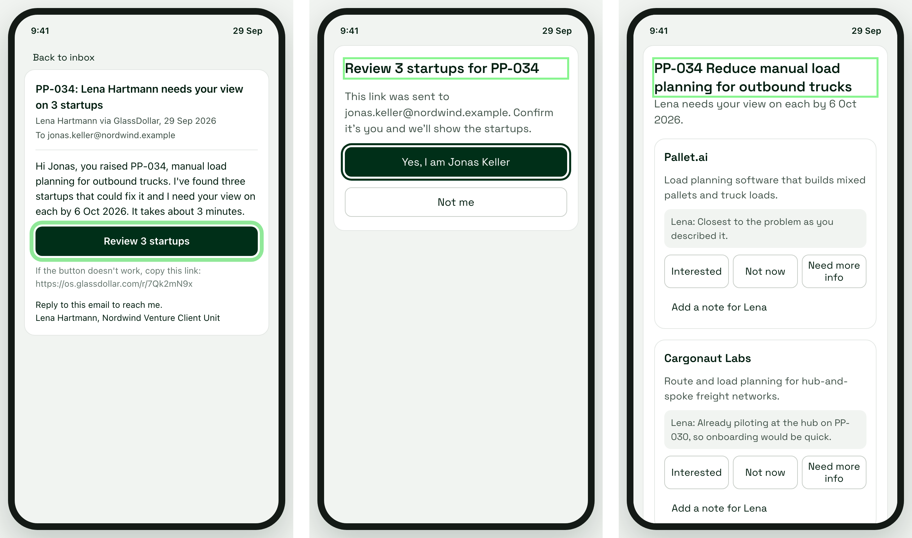
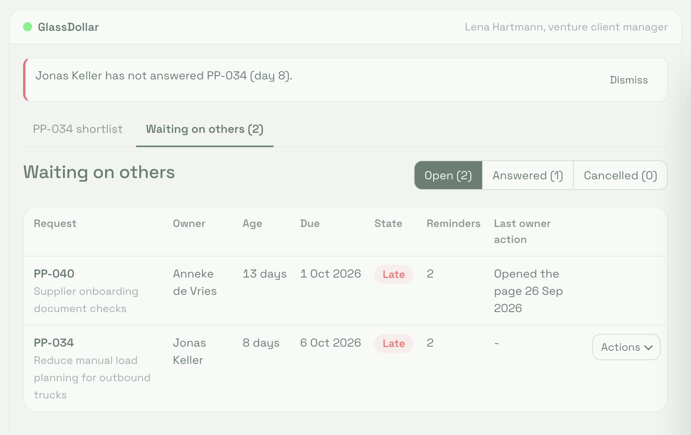

# Tickets: Business units submit a problem and then disappear

## The problem

Lena sends Jonas a shortlist and waits. She chases by email, he cannot find his login, and the pain point sits in Shortlist for weeks. We want to cut the days between "shortlist sent" and "owner answered".

## What we are building

We are building one list for Lena of everything still waiting on someone, filled by decision requests. Lena asks one question from the shortlist. Jonas gets an email with one button and answers on one page in about three minutes. If he goes quiet, the OS reminds him. If he is the wrong person, he names the right one and Lena resends to them from the same dialog.

## The five tickets

Build and deploy them in this order. DR-1 to DR-3 together are the first slice a user gets value from: without the email, DR-1 only records a request, and without the form, DR-2 sends a link to nothing. Two checks gate the build: ask Lena which decisions need the owner (one hour), and test the link and SSO at one real customer (one week).

| Ticket | Title | What it delivers | Area | Skills | Size | Depends on | Status |
|---|---|---|---|---|---|---|---|
| DR-1 | Send and cancel a request from the shortlist | One button opens a dialog with the recipient, owner preselected, and an optional note. Send creates a Waiting request and snapshots the shortlist. The header shows state and age. Cancel takes a reason | Pain points | Backend, frontend | M | Nothing | Ready |
| DR-2 | The email, and a link that survives mail scanners | One email, one button, a plain-text link. A hashed token that lasts 14 days. Nothing counts until "Yes, I am Jonas Keller" is tapped. An expired link says to ask Lena | Notifications, Shared | Backend, email deliverability (SPF, DKIM, DMARC), security | M | DR-1 | Waits on DR-1 |
| DR-3 | Jonas answers on one page, Lena sees it on the shortlist | Phone-first page with three choices per startup, or "None of these fit" with a reason. Answers land on the shortlist with one notification. The owner can name who should answer instead, and Lena resends | Pain points, Shared | Frontend (phone-first form, accessibility), backend | M | DR-1, DR-2 | Waits on DR-2 |
| DR-4 | Reminders on days 3 and 7, Late on day 8, Pause by Lena | Two reminders, skipped if the owner was active in the last 24 hours. Late on day 8 with one alert to Lena. Lena can pause and resume reminders, and a pending handoff pauses them | Notifications | Backend (scheduled jobs) | M | DR-1, DR-2 | Waits on DR-2 |
| DR-5 | The Waiting on others list and the four measures | The list of open requests with row actions Remind now, Cancel, Answer on behalf, Pause and Resume. The four measures as queries over the event log | Pain points, Reports | Frontend, backend (permissions), SQL | M | DR-3, DR-4 | Waits on DR-4 |

Sizes are t-shirt sizes. The whole release is about 3 to 4 engineer-weeks.

Test against the sample data at https://github.com/IamDejman/glassdollar-casestudy-ayodeji/blob/main/data/sample-data.json. In the sample data, today is 12 Oct 2026. It is test data, not a baseline. Read as requests, it has a median wait of 7 days and 8 of 13 shortlists answered by day 7, which is the brief's switch condition, so a test run exercises that condition too.

## Rules for all five tickets

- A request is one question from a manager to one person about one shortlist. The recipient is the pain point owner unless Lena picks someone else. This release has one question: rate this shortlist.
- States: Waiting, Paused, Late, Answered, Cancelled. Waiting, Paused and Late are open. An open request can become Answered or Cancelled. Those two are final.
- One open request per shortlist. Enforce it in the database.
- Days are calendar days from the send date, in Europe/Berlin. Sent 29 Sep 2026: day 3 is 2 Oct, due 6 Oct at 23:59, link expires 13 Oct at 23:59. Age never resets.
- Jobs run at 09:00 on weekdays. Anything due on a weekend runs on Monday.
- Anyone who can edit the pain point can send, cancel, remind, pause, resume or answer on behalf. The event log records who.
- "Tell Lena" means one in-app notification and one email. That is the workspace default in the sample data.
- Nothing closes a request on its own. Day 14 expires the link and nothing else. A Late request stays until Lena acts.
- Finalising the pain point, which means it leaves Shortlist, cancels any open request with the reason "finalised". The owner gets no email, and the link shows "Lena no longer needs this".
- One event table: request_id, type, at, actor, payload. DR-5 lists the types.
- The request record: id, shortlist_id, pain_point_id, sender_id, recipient_id, parent_request_id, state, note, created_at, due_at, expires_at, confirmed_at, answered_at, cancelled_at, cancel_reason, via (magic_link or on_behalf), rated, late, handoff_name, reminders_sent (automatic only), chases (Remind now), token_hash, and the snapshot (startups with description and comment). Each ticket names the fields it writes.
- Event payloads: created {recipient_id, parent_request_id}, link_opened {user_agent}, identity_confirmed {}, not_me {}, reminder_sent {n}, reminder_skipped {reason}, remind_now {}, paused {reason: lena or handoff}, resumed {}, late {}, handoff {name}, answered {via, rated, choices}, cancelled {reason}.
- A chain is a request and its resends. Cancel and resend, Resend to someone else and Ask again all create a new request with parent_request_id set to the old one. The list's Age column is per request. The measures count chains from the first request's created, so the clock never stops across a resend.
- Owner activity means identity_confirmed, a view of the answer page with a session, handoff and answered. link_opened is logged for every fetch, scanners included, and is not activity. Activity drives the reminder skip in DR-4 and the Last owner action column in DR-5.
- Reports go by request and business unit. No query returns an owner's name until the works council question in the brief is answered.
- Sample data: PP-034 is Jonas Keller's. Sent 29 Sep, reminders on 2 and 6 Oct, Late since 7 Oct, day 13 today. PP-040 is Anneke de Vries's, sent 18 Sep, open at day 24.

## Open questions

None of these blocks a build. Each has a default the tickets follow until it is answered.

- Who can Lena send to? Default: any OS user with an email address, the owner preselected. Ask Lena how often the right person is outside the OS.
- Should finalising cancel the request? Default: yes, so nothing stays open on a closed pain point. Ask Lena whether late answers are worth keeping.
- Does Nordwind force SSO on outside links? Default: assume not, and the one-week link test settles it. Ask Nordwind IT.
- One shared GlassDollar sending domain, or one per customer? Default: one shared domain, set up once. Ask Nordwind IT.
- German or English? Default: English until the OS has a workspace language. Ask Lena.
- Should the confirmation promise a reply time, say "within 3 working days"? Default: no promise. Ask Lena.
- Should Need more info keep the request open? Default: no. It is Answered with rated false, and Lena's Ask again starts a new request in the same chain, so the clock does not stop. Ask Lena.
- Calendar or working days for 3, 7 and 8? Ask Lena.
- Public holidays: default is to treat them as weekdays. Ask Lena.
- Read-only access for Dr. Sabine Koch? Default: no. Ask Lena.
- May reports name owners? Default: no, by request and business unit only, until the works council question in the brief is answered. Ask Lena who at Nordwind answers works council questions.

## Not in this release

Listed so the cut is explicit. Nothing here is in scope for the first release.

- Auto-reply and bounce detection, with reminders that pause on their own
- Link renewal after day 14
- One-click send-on with a fresh link, and contacts for people outside the OS
- Answered and Cancelled tabs, and a unit-wide view of the list
- Merged reminder emails for one owner
- Suggested stage change
- Editing a request after sending
- The closing-the-loop email
- The daily digest

The brief says why: https://github.com/IamDejman/glassdollar-casestudy-ayodeji/blob/main/PRODUCT-BRIEF.md.

---

### DR-1: Send and cancel a request from the shortlist

#### Description

Lena has three startups on the PP-034 shortlist and needs Jonas to say which are worth a call. Today she writes an email and hopes. After this ticket she presses one button, sees that the request is out, and can cancel it.

#### What to build

- Add the button "Ask Jonas Keller to rate this shortlist" to the shortlist header while the pain point is in Shortlist. The name is the pain point's owner.
- The button opens a dialog: the recipient, preselected to the owner and changeable to any OS user with an email address, the email they will get, an optional note to them (plain text, 1,000 characters), and "Send request". Until DR-2 exists, show the template text with the names filled in.
- Send creates the request as Waiting, snapshots the shortlist, and logs created. DR-2 sends the email.
- While the request is open, replace the button with its state: "Waiting for Jonas Keller, day 13", "Late: Jonas Keller, day 13" or "Paused: Jonas Keller, day 13". After an answer, DR-3 shows the answers here. After a cancel, bring the button back.
- Add "Cancel request" next to the state. Confirm, take an optional reason, set Cancelled, log cancelled. No email to the owner.
- When a startup is added or removed while a request is open, show "Shortlist changed since the request" with "Cancel and resend". That cancels the request and reopens the dialog with the note filled in.
- The same cancel and resend serves a handoff. When the owner has named someone else (DR-3), the header shows "Resend to Petra Ahlers", which cancels the request and opens the dialog with Petra preselected and the note filled in.

#### User stories

- As Lena, I want to ask Jonas with one button, so that I stop writing chasing emails.
- As Lena, I want the shortlist to show that a request is out and how old it is, so that I know whether to wait or step in.
- As Tobias, covering for Lena, I want to see that a request is already out, so that I don't send a second one.

#### Acceptance criteria

- Lena sends PP-034 on 29 Sep 2026. The request is Waiting, due 6 Oct at 23:59 Europe/Berlin, the link expires 13 Oct at 23:59, reminders_sent is 0, the snapshot holds Pallet.ai, Cargonaut Labs and Parcelgrid with descriptions and comments, and created is logged.
- Tobias opens PP-034 on 12 Oct 2026. He sees "Late: Jonas Keller, day 13" and no send button.
- A shortlist has 2 startups. The button is disabled and reads "Needs 3 to 5 startups".
- Lena adds a fourth startup while the request is open. The banner shows. "Cancel and resend" cancels the old request and opens the dialog with her note. Send creates a new Waiting request with 4 startups and parent_request_id set to the old one.
- Lena picks Petra Ahlers instead of Jonas and sends. The request's recipient is Petra, the email goes to her, and the header reads "Waiting for Petra Ahlers, day 0".
- Lena cancels PP-034 with the reason "Jonas is on leave". The state is Cancelled, the reason is stored, cancelled is logged, Jonas gets no email, and the button is back.
- Lena and Tobias press Send within a second. One request exists. The other sees "Already sent by Lena Hartmann".
- PP-034 is finalised on 12 Oct while the request is open. The request is Cancelled with the reason "finalised", cancelled is logged, Jonas gets no email, and the button does not come back.

#### Edge cases

- No owner, or the owner is not an OS user or has no email address in the OS: open the dialog with no recipient and say why, for example "Henrik Vos is not an OS user" (PP-017). Lena picks someone else or stops. The sender cannot be the recipient.
- Under 3 or over 5 startups: disable the button, "Needs 3 to 5 startups".
- A description or comment edited after sending: no banner. The snapshot stands.
- The pain point's owner changes while a request is open: the request keeps its recipient. The header adds "Owner is now Petra Ahlers" with "Resend to Petra Ahlers", which is the cancel and resend.

---

### DR-2: The email, and a link that survives mail scanners

#### Description

Jonas gets one email with one button. He taps it, confirms it is him, and lands on the answer page. Corporate mail scanners open every link before he does, so nothing counts until a person taps "Yes, I am Jonas Keller".

#### What to build

- Send from "GlassDollar for Nordwind" at a GlassDollar address. Reply-To is Lena, so a human reply, an auto-reply or a bounce reaches her and not the OS.
- Subject: "PP-034: Lena Hartmann needs your view on 3 startups". Body: who asks, what for, "about 3 minutes", Lena's note, the due date. One text button, "Review 3 startups", with the full URL in plain text under it. No startup names.
- The link carries a random token (32 bytes or more, stored hashed) tied to the request and the owner's address, valid until the link expires.
- Opening the link shows "Yes, I am Jonas Keller" and "Not me". The first tap records confirmed_at and sets a session cookie for this request until the link expires. The token stays valid, so the same link works from reminders, other devices and later days. With a session, skip the identity page.
- "Not me": show "Thanks, we've told Lena Hartmann". Change nothing. Tell Lena once per request.
- Expired link: show "This link has expired. Ask Lena Hartmann for a new one." Lena's cancel and resend (DR-1) issues it. Answered request: "Your answer was sent on 12 Oct 2026". Cancelled: "Lena no longer needs this".
- SPF, DKIM and DMARC on the sending domain. Add "allowlist the sender" to the customer setup checklist.

#### User stories

- As Jonas, I want to open the request on my phone with no login, so that I can answer between meetings.
- As Jonas, I want the link to work again tomorrow and on my laptop, so that I am not locked out.
- As Lena, I want to know when someone other than Jonas opened the link, so that I can check with him.

#### Acceptance criteria

- Jonas's PP-034 email contains "Review 3 startups", "about 3 minutes" and 6 Oct 2026. It does not contain Pallet.ai, Cargonaut Labs or Parcelgrid.
- A scanner fetches a new link three times. The request is still Waiting, confirmed_at is empty, and no owner activity is logged.
- Jonas taps on his phone on 1 Oct and opens the link on his laptop on 2 Oct. The laptop shows the identity page once, then the answer page. confirmed_at stays 1 Oct.
- Jonas taps on 13 Oct and the page opens. On 14 Oct he sees "This link has expired. Ask Lena Hartmann for a new one." and nothing is sent.
- Anneke de Vries taps "Not me" on a forwarded email. She sees no startup. Lena is told "Someone other than Jonas Keller opened the PP-034 link".
- Lena cancelled PP-034. Jonas opens the link and sees "Lena no longer needs this", with no identity page.
- Images are blocked. The button is readable text and the URL is visible under it.

#### Edge cases

- A sandbox presses the button: confirmed_at is set. Nothing more can happen without choices, and the measures count answers, not taps.
- The request was cancelled and resent to Petra Ahlers (DR-1): the old link shows "Lena no longer needs this".
- The owner's address changes after sending: the old link keeps working. Use the new address from the next email.
- Accepted risk, to be signed off by Lena before launch: anyone holding the email can tap "Yes, I am Jonas Keller" and see the startup names, descriptions and Lena's comments. That is the DocuSign trade for no login. "Not me" tells Lena, and the link expires after 14 days.

---

### DR-3: Jonas answers on one page, Lena sees it on the shortlist

#### Description

After the identity tap, Jonas gets one page with the three startups and three choices each. He picks, adds a note if he wants, and sends. Lena sees the answers on the shortlist and gets one notification, so she never has to ask twice.

#### What to build

- One page, phone first, no navigation, behind the DR-2 session. Show the PP-034 title, Lena's note, and one card per startup from the snapshot: name, description, Lena's comment, the choices Interested, Not now and Need more info, and a comment box. Below the cards: a "None of these fit" checkbox with a comment box that replaces the choices, and "Send to Lena".
- Require a comment for Need more info and for None of these fit. None of these fit is rated true, since it is a verdict with a reason. Need more info on every startup is rated false. Keep Send enabled. On a missing field, say what is missing and move focus there. Send nothing until it is complete.
- After sending, show "Sent to Lena Hartmann." with a summary. A valid link opened again shows the answer read-only.
- On the shortlist, show each choice with who, when and how. Tell Lena once: "Jonas Keller answered PP-034", or "Jonas Keller needs more information on 3 startups" when nothing was rated.
- After an answer, bring the button back as "Ask Jonas Keller again". That is the follow-up to Need more info. The information itself goes by email or a call.
- Under Send: "Someone else should answer this", with a plain name field. "Tell Lena" keeps the request open, tells Lena "Jonas Keller says Petra Ahlers should answer PP-034", and shows "Sent to Lena Hartmann. She'll send PP-034 to Petra Ahlers." On the shortlist header this becomes "Resend to Petra Ahlers" (DR-1). If he answers afterwards, the answer wins and the name is cleared. A handoff also sets the request to Paused with the reason handoff (DR-4), so Jonas gets no reminder and the request does not go Late while Lena decides. Resend or Resume ends the pause.

#### User stories

- As Jonas, I want to rate three startups on my phone in a couple of minutes, so that Lena gets my view without a meeting.
- As Jonas, I want to say that someone else should answer, so that requests stop landing on me when they are not mine.
- As Lena, I want the answers on the shortlist with one notification, so that I copy nothing out of an email.

#### Acceptance criteria

- After the tap, Jonas sees Pallet.ai, Cargonaut Labs and Parcelgrid with three choices each, Lena's note, and no navigation.
- Jonas rates 2 of 3, or ticks None of these fit without a comment, or sets Need more info without a comment, and presses Send. Nothing is sent. The page says what is missing and focus moves there.
- Jonas sets Pallet.ai to Interested and the others to Not now and sends on 12 Oct 2026. The request is Answered, via is magic_link, rated is true, the shortlist shows "Jonas Keller, 12 Oct 2026, via link", Lena is told once, and the button reads "Ask Jonas Keller again".
- All three are Need more info, each with a comment. The request is Answered, rated is false, and Lena's notification reads "Jonas Keller needs more information on 3 startups".
- Jonas ticks None of these fit with the comment "All three are consumer tools" and sends. The request is Answered, rated is true, and the shortlist shows the comment.
- PP-034 is finalised on 12 Oct and Jonas sends on 13 Oct. late is true and the shortlist shows "received after shortlist was finalised".
- Jonas sends a handoff on 1 Oct. The request is Paused with the reason handoff, Lena is told once, no reminder goes out on 2 Oct, and reopening the link shows "Sent to Lena Hartmann" with Petra's name. He rates all three on 2 Oct: Answered, the name is cleared, and the header no longer offers "Resend to Petra Ahlers".
- Lena answers on behalf at 10:00 and Jonas presses Send at 10:01. He sees "Already answered by Lena Hartmann". Lena's answer stands.

#### Edge cases

- Two tabs submit: the second sees "Already sent".
- Opened after a cancel, including a cancel and resend: "Lena no longer needs this". After an answer on behalf: "Already answered by Lena Hartmann".
- Five startups in the snapshot: five cards, same rules.
- Comments: 1,000 characters, with a counter from 100 left.

---

### DR-4: Reminders on days 3 and 7, Late on day 8, Pause by Lena

#### Description

Today Lena is the reminder system. This ticket moves that into the OS. It sends two automatic reminders, marks the request Late on day 8 so Lena knows when to step in, and lets her pause reminders when she knows Jonas is away.

#### What to build

- On days 3 and 7, send the first email again with "Reminder 1 of 2" or "Reminder 2 of 2" on top and the same link. Subject: "Reminder: PP-034, Lena Hartmann needs your view by 6 Oct 2026". Never more than two.
- Skip a reminder if the owner confirmed identity or opened the page in the last 24 hours, or if Lena pressed Remind now in the last 24 hours.
- On day 8 with no answer, set Late and tell Lena "Jonas Keller has not answered PP-034 (day 8)".
- "Pause reminders", on the shortlist header and in the DR-5 list: set Paused, stop reminders and the Late transition, log paused. Lena uses it when she knows the owner is away. A handoff (DR-3) pauses the same way, with the reason handoff.
- "Resume reminders" sets Waiting, or Late at once if day 8 has passed, logs resumed, and tells Lena once if it went Late. Don't send reminders missed while paused. Send the next one due as normal.
- Make the jobs idempotent: re-check the state and the event log right before sending. Send only when Waiting, fewer than two reminder_sent events, and the pain point still in Shortlist. Remind now never uses up an automatic reminder.

#### User stories

- As Lena, I want the OS to remind Jonas twice, so that I only chase when that failed.
- As Lena, I want to pause reminders when I know Jonas is away, so that he does not come back to three nagging emails.
- As Lena, I want to be told on day 8, so that I know when to pick up the phone.

#### Acceptance criteria

- Sent 29 Sep 2026, no answer. Reminders go out on 2 Oct and 6 Oct at 09:00, reminders_sent is 2, and on 7 Oct the state is Late and Lena gets one in-app notification and one email.
- Jonas opened the page on 2 Oct at 08:10. The 09:00 job sends nothing. The day 7 reminder still goes out on 6 Oct.
- Lena pauses on 3 Oct. The state is Paused, paused is logged, and no day 7 reminder goes out.
- Lena resumes on 4 Oct: Waiting, and the day 7 reminder goes out on 6 Oct. Lena resumes on 9 Oct: Late at the next run, told once.
- PP-034 is finalised on 5 Oct. The request is Cancelled, no reminder on 6 Oct, never Late.
- The sample data on 12 Oct. The jobs send nothing and PP-034 stays Late.
- Lena presses Remind now on 30 Sep. reminders_sent stays 0 and chases is 1. The reminders still go out on 2 Oct and 6 Oct.
- Jonas sends a handoff on 1 Oct and Lena does nothing. No reminder on 2 Oct or 6 Oct, never Late. She presses Resume on 9 Oct: Late at the next run, told once.

#### Edge cases

- The owner answers between the check and the send: abort.
- Pause on a Late request: it stays Late and only the pause is logged. Resume changes nothing.
- Resume before day 7: send day 7, skip the missed day 3.
- The job runs twice: one email, because the second run finds the reminder_sent event.
- Day 3 on a Saturday: Monday at 09:00.
- A pending handoff: Paused with the reason handoff, no reminders, no Late, until Lena resends or resumes.

---

### DR-5: The Waiting on others list and the four measures

#### Description

Lena needs one place that shows everything still waiting on someone and lets her act from there. The product team needs to know whether any of this worked, so the same ticket adds the four measures as queries over the event log.

#### What to build

- Add the page "Waiting on others" under Pain points. It lists the open requests of the innovation manager who is logged in. Answered and cancelled requests show on their shortlists.
- Columns: Request, Owner, Age, Due, State, Reminders, Last owner action. Reminders shows reminders_sent, with "+1 manual" when Lena has pressed Remind now. Last owner action is the latest owner activity from the rules. Sort Late first, then oldest, then request id. Show "-" in empty cells. Empty list: "Nothing is waiting on anyone."
- Row actions by state. Waiting and Late: Open shortlist, Remind now, Cancel, Answer on behalf, Pause reminders, and "Resend to Petra Ahlers" when the owner has named someone. Paused: the same with Resume reminders instead of Pause, and Remind now warns "Reminders are paused".
- Remind now sends the DR-4 reminder now, adds 1 to chases, and logs remind_now, which counts as a manual chase. It never uses up an automatic reminder. Then show "Reminded today" for 24 hours.
- Cancel is DR-1's cancel.
- Answer on behalf opens the DR-3 form with a required note, default "recorded by Lena Hartmann from a call". via is on_behalf. No email to the owner. His link then shows "Already answered by Lena Hartmann".
- "Resend to Petra Ahlers" is DR-1's cancel and resend with Petra preselected. The old link shows "Lena no longer needs this".
- Event types: created, link_opened, identity_confirmed, not_me, reminder_sent, reminder_skipped, remind_now, paused, resumed, late, handoff, answered, cancelled.
- Four queries over the chains whose first request was created in a period, with no screen yet. Cancelled chains are left out, and no query returns an owner's name:
  - Days to answer: the median days from the chain's first created to answered over chains answered with rated true, and the share of chains answered by day 7, with open chains counted as misses.
  - First touch: the share of chains answered within one working day of the first created. This is the one measure in working days, as the brief defines it.
  - No manual chase: the share of answered chains with no remind_now and no on_behalf answer.
  - Late rate: the share of chains whose wait (answered minus first created, or today minus first created while open) is more than 1.2 times the business unit's median, or more than 8 days until the business unit has 10 answered chains.

#### User stories

- As Lena, I want one list of everything waiting on someone, so that nothing I own stalls without me knowing.
- As Lena, I want to remind, cancel or answer on behalf from the list, so that I don't open each pain point to act.
- As the product team, we want the four measures as queries, so that after a quarter we know whether the wait got shorter.

#### Acceptance criteria

- The sample data on 12 Oct 2026. PP-034 shows Jonas Keller, age 13, due 6 Oct, Late, 2 reminders, last owner action "-". PP-040 (Anneke de Vries, age 24, Late) sorts above it.
- Tobias sees only his own requests. He opens PP-034 from the pain point and presses Remind now there: it is logged under his name.
- Lena presses Remind now on PP-034. reminders_sent stays 2, chases is 1, the Reminders cell reads "2 +1 manual", remind_now is logged, Jonas gets the email, and the button reads "Reminded today" for 24 hours.
- Lena answers on behalf for PP-034 with the default note. Answered, via on_behalf, the note is on the shortlist, Jonas gets no email, his link shows "Already answered by Lena Hartmann", and the request counts as manually chased.
- The sample data read as chains of one request each (sent_to_owner_at is created, owner_feedback_at is answered when complete, partial is open, the sample data's reminders_sent are chases): a median of 7 days over 11 answered, 8 of 13 by day 7, 9 of 11 without a chase, and a late rate of 3 of 13 (PP-019, PP-034, PP-040).
- No open requests. "Nothing is waiting on anyone."
- PP-034 has a handoff to Petra Ahlers. Lena presses "Resend to Petra Ahlers" on 1 Oct and sends. The old request is Cancelled, a new one is Waiting for Petra from 1 Oct with due_at 8 Oct, reminders_sent 0 and parent_request_id set to the old one, so the chain still counts from 29 Sep. Petra gets the DR-2 email, Jonas gets nothing, and his link shows "Lena no longer needs this".
- Lena pauses PP-034 from the list on 3 Oct and resumes on 9 Oct: Paused, then Late at the next run, told once.
- A query result lists chains by request id and business unit. No column holds an owner's name or user id.

#### Edge cases

- Two managers act at once: the first wins, the second sees "Already answered".
- A late answer: the row shows "received after shortlist was finalised".
- The named person is the sender, or is not in the OS: open the dialog with no recipient and say why, so Lena picks someone.
- Remind now at 08:59 and the job at 09:00: skip the automatic reminder.
- The new recipient may already have another request open. The limit is per shortlist, not per person.

---

## Prototype screenshots

From the [live prototype](https://iamdejman.github.io/glassdollar-casestudy-ayodeji/).

**Lena sends one request from the shortlist.** The dialog shows who will get it, the due date, the reminder days and when the request goes late.

**Jonas answers on his phone with no login.** He gets one email with one button. A tap to confirm it is him stops mail scanners from answering for him. Then he rates each startup with one of three choices.

**Lena tracks everything in one list.** On day 8 the request goes Late and she hears about it once. Each row shows owner, age, due date, state and reminders, with Remind now, Cancel and Answer on behalf.

